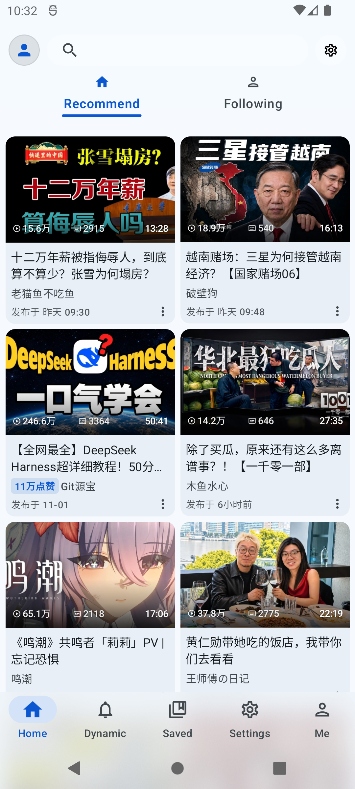
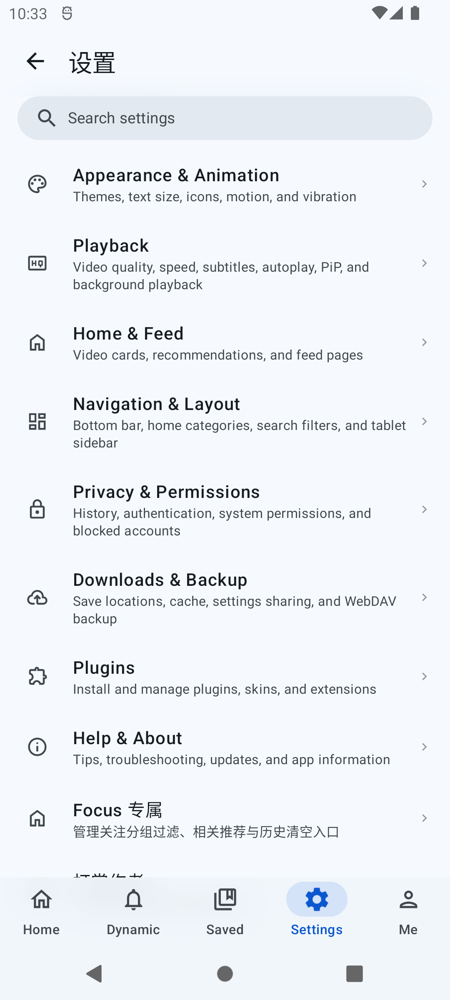
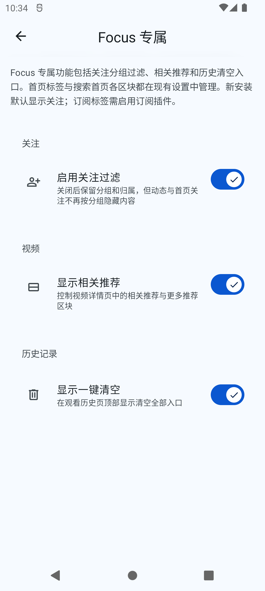
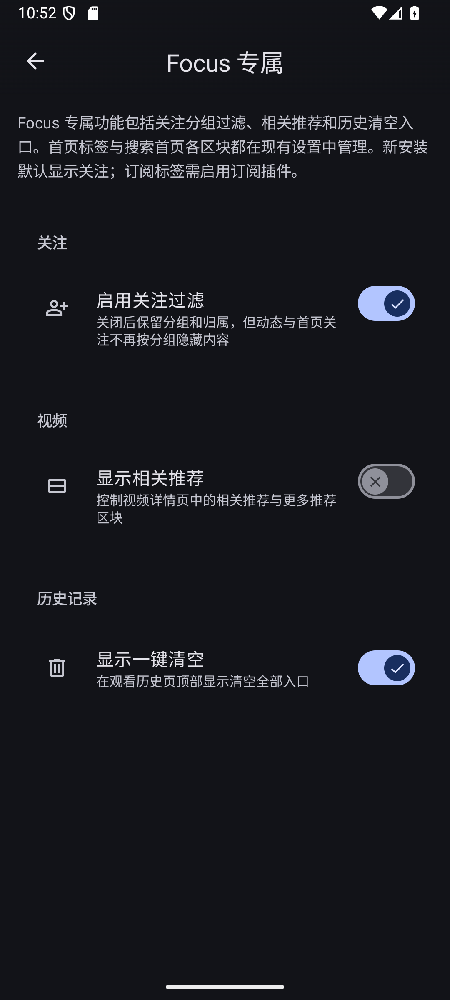

<h1>BiliPai Focus</h1>

BiliPai Focus is a third-party Android client based on BiliPai. It lets you browse and watch Bilibili content while keeping Focus controls for followed-account filtering, related videos, and history actions.

<a href="README.md">简体中文</a> · <a href="https://github.com/AIALRA-0/BiliPai_Focus/releases/latest">Download the latest published release</a> · <a href="CHANGELOG.md">Changelog</a> · <a href="https://github.com/jay3-yy/BiliPai">BiliPai upstream</a>

Current source candidate: <code>0.7.9-beta.7.focus.1</code> / Android update code <code>390</code> (not released) · Upstream base: <code>0.7.9-beta.7</code> (beta) Latest published Focus version: <code>0.2.3-alpha.2.focus.1</code> / Android update code <code>389</code>

Figure 1.1 Android API 31 light-theme home screen: after launch, you can browse public videos without signing in; the image shows the recommendation feed and main navigation.

## 1 What can this project do

BiliPai Focus follows the [BiliPai upstream project](https://github.com/jay3-yy/BiliPai) and retains its video, anime, live, activity-feed, search, messaging, and offline-download features. Focus also maintains its own controls for followed-account filtering, related videos, and history actions. It is not an official Bilibili client and is not affiliated with Bilibili.

## 2 What is the status of this version

The current source sets the Focus version to `0.7.9-beta.7.focus.1` and Android update code (`versionCode`) to `390`, based on upstream `0.7.9-beta.7`. This is an unreleased source candidate; no Focus Release package for it is available yet.

The version name follows the upstream beta.7 release line; the source is synchronized through upstream `main` commit `05c4e2ac5`.

[Focus Releases](https://github.com/AIALRA-0/BiliPai_Focus/releases/latest) currently provides the latest published Focus version, `0.2.3-alpha.2.focus.1` / `389`. See the [versioning guide](docs/wiki/VERSIONING.md) for version names and the Focus stable update channel. The upstream base is still beta, so it is not an upstream stable release.

## 3 How do I install the latest published version

The app targets Android 8.0 (API 26) and later on 64-bit ARM devices. Playback quality depends on account permissions, video availability, and device decoding support. You can browse public content without signing in; some features, including saved items, following anime, and higher quality tiers, may require an account.

- Step 1: Open [Focus Releases](https://github.com/AIALRA-0/BiliPai_Focus/releases/latest), read the release notes, and confirm that you are downloading the Focus package (APK).
- Step 2: Download and open the APK on your Android device. If prompted, allow installation from the source you used to open it.
- Step 3: Open the app. You can start with public content; sign in when a feature requires account access.
- Step 4: If the sign-in page offers several methods, follow its instructions to use TV QR, phone and password, SMS verification, or Cookie import.

Online playback, search, sign-in, and update checks require a network connection; importing a plugin by URL does too. Downloaded videos can play locally. The [user FAQ](docs/wiki/FAQ.md) covers account and network questions.

## 4 Which controls does Focus add

The **Focus-specific** settings page keeps three controls that belong to this fork:

Figure 4.1 Android API 31 light-theme Settings screen: open the Focus-specific controls from the Settings home.

- Follow filtering: when disabled, the app keeps your follow groups and their membership but no longer hides items by group in the home Following feed or activity feed.
- Related videos: controls the related-video and more-recommendations sections on video detail pages.
- Clear history: controls whether the watch-history page shows a clear-all action.

Figure 4.2 Android API 31 light-theme Focus-specific page: the page groups the Follow filtering, Related videos, and Clear history controls.

Figure 4.3 Android API 36 dark-theme Focus-specific page: the three controls remain readable in dark mode; Related videos is disabled and the other two switches are enabled in this screenshot.

Upstream navigation settings now control home-tab visibility and order. When an older Focus install upgrades, the app migrates the tabs that were actually visible and preserves their order. A fresh install shows Following by default; the Subscriptions tab appears when the subscriptions plugin is enabled. Search landing sections use the existing settings and are no longer listed as Focus-specific controls.

## 5 Which upstream features does it retain

- Video playback supports DASH, MP4, danmaku, gestures, speed controls, saved playback position, background play, picture-in-picture, and multiple quality tiers. Available quality depends on the account, video, and device.
- Audio mode includes immersive and vinyl layouts, lyrics, queues, a sleep timer, system media controls, and Android Auto.
- The home-screen widget can show the current title and playback controls, resume audio, and open Watch later or Search.
- Subtitles and notes support local subtitle import and export, style and timing changes, private video notes, timestamps, and AI-summary drafts. AI summaries need a configured service.
- Anime and live features include following, episode selection, live categories, and real-time danmaku, with layouts for phones, tablets, and foldables.
- Home, search, categories, activity feeds, comments, profiles, articles, messages, direct messages, history, favorites, and Watch later cover common browsing and interaction tasks. Feeds support replies and image previews.
- Offline downloads support resuming and local playback. DLNA and Google Cast can send content to compatible devices; WebDAV can back up and restore settings.
- Appearance options include Material 3, Miuix, iOS-style components, optional Liquid Glass, dynamic colors, and elastic motion. The home screen also supports regular grids and large-screen layouts.

See the [system media guide](docs/wiki/SYSTEM_MEDIA.md) for the home-screen widget and Android Auto. The [changelog](CHANGELOG.md) lists source updates.

## 6 What changed with the beta.7 merge

The current candidate is based on upstream `0.7.9-beta.7`. Notable changes include:

- A new **Show comments on landscape back** option: when enabled, the first Back action opens comments in landscape fullscreen; the next returns to the previous level while keeping landscape orientation.
- System card transitions now cover additional shop-product, article, activity-detail, creator-search, and live-category pages.
- Focus fixed the backup-line timer so ordinary playback does not switch lines early when that timer resets. A real playback error can still trigger a backup line.

These changes are part of the source candidate and have not shipped in a Focus Release. See the [changelog](CHANGELOG.md) for the complete record.

### 6.1 What else has the upstream project recently improved

- Content pages and cards: recommendation cards identify portrait videos, and the activity feed can hide its top creator row. Landscape danmaku styling and player loading or buffering indicators have also improved.
- Playback and history: short videos resume unseen items after returning home, and the app records watch history only after actual playback. Fullscreen-to-mini-player transitions release the orientation lock; Watch later cards now have a remove action.
- Search and comments: search input now updates the query without resetting cursors or IME composition. Comment translation handles Chinese replies and mixed-language text, while reply threads keep their scroll position.

## 7 What can plugins do, and what should I check before importing one

Built-in plugins cover sponsor skipping, ad filtering, Anime4K, danmaku tools, eye care, Today Watch, CDN selection, feed filtering, subscriptions, and casting. The plugin center can also edit JSON rules, check their syntax, preview filtering, and show matching results.

- JSON or `.bp` rules can be imported by URL to filter recommendations or danmaku. These are declarative rules and do not run arbitrary code; see the [plugin development guide](docs/PLUGIN_DEVELOPMENT.md).
- Enhanced ad filtering can also block keywords in actual video tags across home recommendations, search results, and related videos. With no keywords configured, it makes no extra tag requests; failed or timed-out lookups keep videos whose tags could not be checked.
- JavaScript plugins can provide external content catalogs and media playback sources, and can be imported from a local file or URL. The app runs their code in its embedded browser (WebView) and shows declared permissions before installation. Review the source, data sources, and requested permissions first.
- `.bpskin` is a data-only skin package for supported images, colors, and interface resources. It does not execute code; see the [skin package guide](plugins/samples/winter-cloud-skin/README.md).
- External `.bpplugin` Kotlin packages show package details, signature or hash status, and requested capabilities. The host does not run their Dex code yet; see the [Plugin SDK guide](plugins/sdk/README.md).
- Native Kotlin plugins require source changes and a new build; see the [native plugin development guide](docs/NATIVE_PLUGIN_DEVELOPMENT.md).

First Visit Recommendation adapts work by wangdaodao's [TabulaBili](https://github.com/wangdaodao/TabulaBili) and tjsky's [TabulaBili-Plus](https://github.com/tjsky/TabulaBili). This reference does not imply an affiliation with those authors.

## 8 How do I build from source

The repository includes a Gradle Wrapper and requires JDK 21 and Android SDK 37. Android Studio and the local SDK must also support the Android Gradle Plugin and SDK versions declared by the build scripts. The Miuix dependency is hosted on GitHub Packages, which requires authentication even though the package is public. Put `gpr.user` and `gpr.key` in your local `~/.gradle/gradle.properties`, or provide `GITHUB_ACTOR` and `GITHUB_TOKEN`. Do not commit access tokens to the repository.

Run these commands in a terminal to compile the app's Kotlin source. This task does not create an APK. In Windows PowerShell, use `.\gradlew.bat :app:compileDebugKotlin`.

<pre><code># Run from the repository root with JDK 21 and Android SDK 37
git clone https://github.com/AIALRA-0/BiliPai_Focus.git
cd BiliPai_Focus
./gradlew :app:compileDebugKotlin</code></pre>

Maintainers can create an installable local development package with `:app:assembleDev`. Dev and official Focus Release builds use different signing configurations; an official Release requires the Focus signing configuration held by maintainers. `app/google-services.json` is optional; when present, the build enables Firebase Crashlytics and Analytics. See the [release workflow](docs/wiki/RELEASE_WORKFLOW.md).

## 9 What data uses the network

Login credentials are stored locally and sent directly from the device to official Bilibili APIs; the project does not operate its own account server. If a build includes Firebase configuration, crash reports and usage statistics are sent to Google Firebase while their settings are enabled. Both settings are on by default, and you can turn them off separately. The in-app privacy notice lists the data categories, including crash stacks, device and system information, and anonymous activity, page-view, basic-feature, version, and language-region statistics.

When reporting an issue, do not publish Cookies, access tokens, passwords, account QR codes, or unredacted logs. Third-party JavaScript plugins can also access the network or plugin storage when they declare and receive those permissions; inspect their source and permissions before importing them.

## 10 Where can I find documentation or report a problem

- [User FAQ](docs/wiki/FAQ.md): accounts, networking, privacy, and common questions.
- [System media guide](docs/wiki/SYSTEM_MEDIA.md): home-screen widget and Android Auto.
- [Plugin development guide](docs/PLUGIN_DEVELOPMENT.md), [native plugin guide](docs/NATIVE_PLUGIN_DEVELOPMENT.md), and [Plugin SDK](plugins/sdk/README.md): JSON rules and JavaScript or Kotlin plugins.
- [Versioning](docs/wiki/VERSIONING.md), [release workflow](docs/wiki/RELEASE_WORKFLOW.md), and [changelog](CHANGELOG.md): version names, Releases, and source changes.
- [Focus Issues](https://github.com/AIALRA-0/BiliPai_Focus/issues): report Focus-specific problems.
- [BiliPai Issues](https://github.com/jay3-yy/BiliPai/issues): report problems shared with upstream.
- [Focus Pull Requests](https://github.com/AIALRA-0/BiliPai_Focus/pulls): propose code, test, or documentation changes.
- [Documentation index](docs/wiki/README.md): browse the wiki documentation.
- [Upstream Telegram channel](https://t.me/bilipai666), [upstream Telegram group](https://t.me/bilipai888/1), and [upstream X account](https://x.com/YangY_0x00): upstream announcements and community information.

When reporting an issue, include the version, device, Android version, and steps to reproduce. Remove account credentials, personal information, and other users' activity from screenshots or logs.

To contribute, fork the repository and create a `feature/*` or `fix/*` branch. Describe the goal, scope, and checks actually completed in your pull request.

## 11 Where can I read the license terms

The repository's [LICENSE](LICENSE) contains the GNU GPL v3.0 text. The in-app user agreement also prohibits sale, paid downloads, and distribution for profit. The applicable scope of these statements needs clarification from the maintainers; confirm it before reusing or distributing the code. Third-party dependencies, assets, and services remain subject to their own licenses and platform rules. See [THIRD_PARTY_NOTICES.md](THIRD_PARTY_NOTICES.md) for their sources.

## 12 Which projects and authors provide foundations or references

Focus inherits and continues to sync code and project documentation from [BiliPai](https://github.com/jay3-yy/BiliPai). Major dependencies and references include:

- [Kotlin](https://kotlinlang.org/): programming language and coroutines.
- [Jetpack Compose](https://developer.android.com/jetpack/compose): declarative UI toolkit.
- [AndroidX Media3](https://github.com/androidx/media): media and video playback components.
- [FFmpeg](https://ffmpeg.org/): audio decoding.
- [Room](https://developer.android.com/training/data-storage/room) and [DataStore](https://developer.android.com/topic/libraries/architecture/datastore): local database and preferences.
- [Retrofit](https://github.com/square/retrofit) and [OkHttp](https://github.com/square/okhttp): network requests.
- [Coil](https://github.com/coil-kt/coil): image loading.
- [Lottie](https://github.com/airbnb/lottie-android): vector animation.
- [MaterialKolor](https://github.com/jordond/MaterialKolor): dynamic theme colors.
- [Compose Rich Editor](https://github.com/MohamedRejeb/Compose-Rich-Editor): rich text editing.
- [DanmakuRenderEngine](https://github.com/bytedance/DanmakuRenderEngine): danmaku rendering.
- [BiliBili-API-collect](https://github.com/SocialSisterYi/bilibili-API-collect) and [BiliBiliSponsorBlock](https://github.com/hanydd/BilibiliSponsorBlock): public API reference and sponsor-skip data.
- [Miuix](https://github.com/compose-miuix-ui/miuix), [Haze](https://github.com/chrisbanes/haze), and [BiliPai-miuix](https://github.com/Piracola/BiliPai-miuix): UI components, blur effects, and an upstream design-system contribution by @piracola.
- [Compose Cupertino](https://github.com/alexzhirkevich/compose-cupertino): iOS-style UI components.
- [PiliPlus](https://github.com/bggRGjQaUbCoE/PiliPlus): mobile interaction reference and source of a player animation asset.
- [Bili Pilot](https://github.com/siwei-yuan/bili-pilot): CDN-routing reference. Focus has an independent Kotlin implementation and does not copy its JavaScript code.
- [SharedViewKit / SharedViewDemo](https://gitee.com/itgsa_sharedviewkit/SharedViewDemo): video-card transition SDK and integration reference from the Gold Standard Alliance (ITGSA); Xiaomi HyperOS system motion supplied motion-parameter references.
- [TabulaBili](https://github.com/wangdaodao/TabulaBili) and [TabulaBili-Plus](https://github.com/tjsky/TabulaBili): references adapted for First Visit Recommendation.

See the [Gradle version catalog](gradle/libs.versions.toml) and [THIRD_PARTY_NOTICES.md](THIRD_PARTY_NOTICES.md) for dependency versions and third-party notices.
