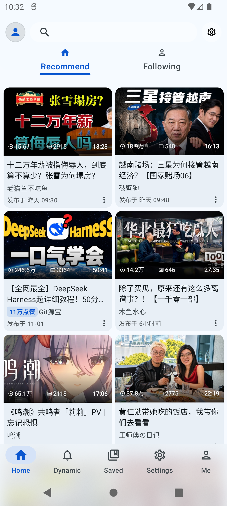
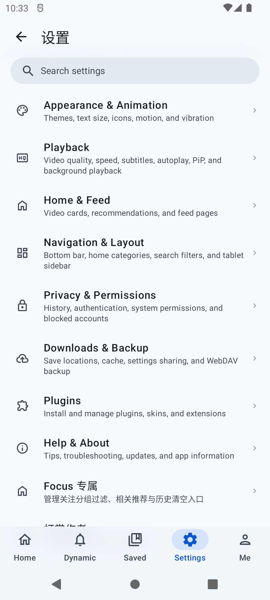
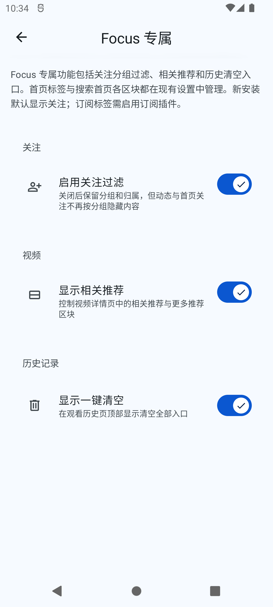
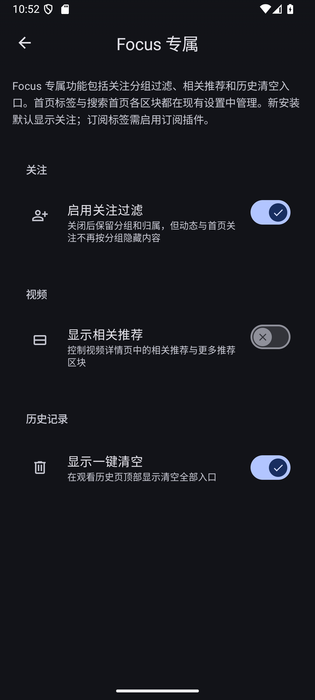

<h1>BiliPai Focus</h1>

BiliPai Focus 是基于 BiliPai 的第三方 Android 客户端，供你浏览和播放哔哩哔哩内容，并单独调整关注过滤、相关推荐与历史记录入口

<a href="README.en.md">English</a> · <a href="https://github.com/AIALRA-0/BiliPai_Focus/releases/tag/v0.7.9-beta.9.focus.2">Focus 0.7.9-beta.9.focus.2 版本页</a> · <a href="CHANGELOG.md">更新记录</a> · <a href="https://github.com/jay3-yy/BiliPai">上游 BiliPai</a>

当前源码版本：<code>0.7.9-beta.9.focus.2</code> / Android 应用升级序号 <code>versionCode 392</code> · 上游基线：<code>0.7.9-beta.9</code>（beta）· 发布状态与安装包以版本页为准

图 1.1 Android API 31 浅色主题首页：打开应用后可以未登录浏览公开视频，画面展示推荐列表和主要导航

## 1 这个项目能做什么

本项目以 [BiliPai](https://github.com/jay3-yy/BiliPai) 为上游

Focus 延续上游的内容浏览、互动和离线缓存能力

Focus 专属的内容控制见下文

它不是哔哩哔哩官方客户端，也不代表哔哩哔哩官方立场

## 2 这个版本目前处于什么状态

当前源码记录的 Focus 版本为 `0.7.9-beta.9.focus.2`，Android 应用升级序号 `versionCode` 为 `392`，上游基础版本是 `0.7.9-beta.9`

源码已同步到上游 `main` 的 `199164c0b` 提交；版本名保留上游版本号，并追加 Focus 渠道序号

Focus Release 页面会显示该版本的发布状态与安装包；只有页面列出对应的 Focus APK 后，才能从该页面下载安装

版本号规则和 Focus 稳定更新渠道说明见[版本规范](docs/wiki/VERSIONING.md)

“稳定更新渠道”指 Focus 自己的分发渠道；上游基础版本仍是 beta，不代表上游稳定版

## 3 我怎样安装这个版本

安装包面向 Android 8.0（API 26）及更新版本的 64 位 ARM 设备

播放清晰度取决于账号权限、视频资源和设备解码能力

浏览公开内容不要求登录

收藏或追番等账号功能可能需要登录，高清画质也取决于账号权限

- 第一步，打开 [Focus 0.7.9-beta.9.focus.2 Release 页面](https://github.com/AIALRA-0/BiliPai_Focus/releases/tag/v0.7.9-beta.9.focus.2)，阅读发布说明
  只有页面列出对应的 Focus APK 后，才下载并安装；如果还没有安装包，请等 CI 发布该版本资产
- 第二步，在 Android 设备上下载并打开 APK；如果系统询问，请允许当前来源安装应用
- 第三步，打开应用后，你可以先浏览公开内容；使用需要账号权限的功能时，应用会提示登录
- 第四步，如果登录页面提供多种方式，请按页面说明选择 TV 扫码、手机号密码、短信验证码或 Cookie 导入

在线播放、搜索、登录和检查更新需要网络

通过 URL 导入插件时也需要网络，已下载的视频可在本地播放

账号及网络相关问题见[用户问答](docs/wiki/FAQ.md)

## 4 Focus 增加了哪些内容控制

设置首页中的“Focus 专属”页面保留本分支独有的三项控制：

图 4.1 Android API 31 浅色主题设置页：从设置首页可以进入 Focus 专属控制

- 关闭关注过滤后，系统仍保留关注分组及其归属，但首页关注流和动态页不再按分组隐藏内容
- 视频相关推荐：控制视频详情页中的相关推荐与更多推荐区块
- 历史清空入口：控制观看历史页是否显示一键清空操作

图 4.2 Android API 31 浅色主题 Focus 专属页：进入该页面后可以看到关注过滤、相关推荐和历史清空入口三个控制

图 4.3 Android API 36 暗色主题下的 Focus 专属页显示相关推荐开关关闭，其余两项开启

首页标签的显示和排序现在由上游导航设置统一管理

旧版 Focus 用户升级时，应用会根据原来实际显示的标签迁移设置并保留顺序

新安装默认显示“关注”，启用订阅插件后才会出现“订阅”标签

搜索首页的热搜、发现和历史区块也使用现有设置，不再放在“Focus 专属”页面中

## 5 它从上游继承了哪些能力

- 视频播放支持 DASH、MP4、弹幕、手势、倍速、播放进度记忆、后台播放、画中画和多种清晰度；实际可用清晰度由账号、视频和设备决定
- 听视频提供沉浸式与黑胶界面、歌词、播放队列、定时关闭、系统媒体控制和 Android Auto
- 桌面小组件可显示当前播放标题并提供播放控制，也能续播音频，或从桌面打开稍后再看和搜索
- 字幕和笔记支持本地字幕导入导出、样式与时间调整，以及视频私有笔记、时间点和 AI 总结草稿；AI 总结需要相应服务配置
- 番剧和直播支持追番、选集、直播分区和实时弹幕，并提供手机、平板与折叠屏布局
- 首页、搜索、分区、动态、评论、个人空间、文章、消息、私信、历史、收藏和稍后再看覆盖常见内容浏览与互动流程；动态支持回复和图片预览
- 离线缓存支持下载续传和本地播放；DLNA 与 Google Cast 可将内容投到兼容设备；WebDAV 可备份和恢复设置
- 外观可在 Material 3、Miuix 和 iOS 风格组件间选择，并按设置使用液态玻璃、动态取色和弹性动效；首页也支持规则网格与大屏布局

桌面小组件与 Android Auto 的使用说明见[系统媒体指南](docs/wiki/SYSTEM_MEDIA.md)；完整更新记录见 [CHANGELOG.md](CHANGELOG.md)

## 6 beta.9 同步带来了哪些变化

当前源码以 `0.7.9-beta.9` 为上游基础，基线是上游 `main` 提交 `199164c0b`

上游 beta.9 带来以下可见变化：

- 半屏与横屏全屏来回切换时，播放器会保留已经显示的弹幕和时间线，避免重新刷新
- 中央播放或暂停按钮可以统一关闭，默认位置移到左下角；玻璃时间胶囊也与相邻按钮保持同高
- 返回首页时的视频卡片过渡得到修正，折叠播放器恢复“更多”菜单入口
- 手机和平板视频详情页从骨架占位切换到正文时更连贯；统计、发布时间、在线人数和 AI／笔记入口也调整了布局，减少窄屏拥挤；MD3 标签改用原生组件
- 顶栏模糊、玻璃弹窗和标签高光做了调整；关闭女仆动效后，点赞特效也会关闭

Focus 在本次同步中还修复了起播恢复：

- 预加载后会保留备用线路状态；如果首帧超过原有 10 秒门槛仍未出现且存在备用线路，播放器会尝试恢复
- 起播时所有线路都返回 HTTP 错误后，页面会保留失败原因和重试按钮；点击重试会重新开始一次有界线路尝试

### 6.1 beta.8 同步带来了哪些变化

- 根评论不可读时，从“回复我的”、消息或外链进入会加载目标回复所在的对话列表，并保留部分结果提示、分页和下拉重试
- 网格列数分别记住窄屏、宽屏竖屏和宽屏横屏设置，并按当前窗口比例切换；首页、搜索、个人列表、UP 主空间和插件内容页都使用这项设置
- 顶栏模糊方案减少重复采样；部分隐藏的骨架与装饰动画会停止运行，并遵守减少动态效果设置

### 6.2 beta.7 历史更新

旧版 Focus 以 `0.7.9-beta.7` 为上游基础，版本名为 `0.7.9-beta.7.focus.1`，`versionCode 390`

详情见 [Focus 0.7.9-beta.7 Release 页面](https://github.com/AIALRA-0/BiliPai_Focus/releases/tag/v0.7.9-beta.7.focus.1)

当时的主要变化如下：

- 横屏全屏新增“返回时显示评论”选项；打开后，第一次按返回键会打开评论，再按一次才返回上一级，并保持横屏
- 小店商品、专栏、动态详情、UP 主搜索和直播分区等页面补齐了从来源卡片进入详情的系统转场
- Focus 修复了备用线路计时器：普通视频不会因计时器重置而提前切换线路，播放确实报错时仍可尝试备用线路

完整版本记录见 [CHANGELOG.md](CHANGELOG.md)

## 7 插件可以做什么，导入前要检查什么

内置插件涵盖空降助手、去广告、Anime4K、弹幕增强、护眼、今日推荐、CDN 线路选择、推荐过滤、订阅和投屏；插件中心也支持编写 JSON 规则、检查语法、预览过滤结果和查看命中内容

- JSON 或 `.bp` 规则可以通过 URL 导入，用于声明式的推荐内容或弹幕过滤；规则本身不运行任意代码，格式见[插件开发指南](docs/PLUGIN_DEVELOPMENT.md)
- 去广告增强也支持按视频标签关键词过滤首页推荐、搜索结果和详情相关推荐；没有配置关键词时不会额外请求标签，查询失败或超时时会保留无法确认命中的视频
- JavaScript 插件可提供外部内容目录和媒体播放来源，也可从本地文件或 URL 导入；应用会在内置浏览器（WebView）中运行插件代码，并在安装前显示它声明的权限；导入前请检查源码、数据来源和权限
- `.bpskin` 是数据型皮肤包，可提供受支持的图片、颜色和界面资源，不会执行代码；样例见[皮肤包说明](plugins/samples/winter-cloud-skin/README.md)
- 外部 `.bpplugin` Kotlin 包会显示包信息、签名或哈希状态和能力申请，但宿主目前不会运行包内 Dex 代码；接口说明见 [Plugin SDK](plugins/sdk/README.md)
- 原生 Kotlin 插件需要修改源码并重新构建；开发入口见[原生插件开发指南](docs/NATIVE_PLUGIN_DEVELOPMENT.md)

初见推荐改编参考了以下两个项目，这项参考不表示 Focus 与原作者存在隶属关系

- wangdaodao 的 [TabulaBili](https://github.com/wangdaodaodao/TabulaBili)
- tjsky 的 [TabulaBili-Plus](https://github.com/tjsky/TabulaBili)

## 8 我怎样从源码构建

本项目使用仓库自带的 Gradle Wrapper、JDK 21 和 Android SDK 37

Android Studio 与本机 SDK 还需要支持构建脚本中声明的 Android Gradle Plugin 和 SDK 版本

GitHub Packages 上的 Miuix 依赖要求身份验证，即使软件包公开也需要凭据

请将 `gpr.user` 与 `gpr.key` 放在本机 `~/.gradle/gradle.properties`，或提供 `GITHUB_ACTOR` 与 `GITHUB_TOKEN`，不要把访问令牌提交到仓库

在终端中运行以下命令，可以编译应用 Kotlin 源码，这项任务不会生成 APK

Windows PowerShell 可使用 `.\gradlew.bat :app:compileDebugKotlin`

<pre><code># 在 JDK 21 和 Android SDK 37 环境中，从仓库根目录运行
git clone https://github.com/AIALRA-0/BiliPai_Focus.git
cd BiliPai_Focus
./gradlew :app:compileDebugKotlin</code></pre>

维护者需要可安装的本地开发包时，可运行 `:app:assembleDev`

Dev 与正式 Focus Release 使用不同的签名配置，正式 Release 需要维护者保管的 Focus 签名配置

`app/google-services.json` 是可选构建配置，文件存在时，构建会启用 Firebase Crashlytics 和 Analytics

发布步骤见[发布流程](docs/wiki/RELEASE_WORKFLOW.md)

## 9 使用时哪些数据会联网

登录凭证保存在设备本地，由设备直接发送给 Bilibili 官方接口

项目没有自建账号服务器

如果构建包含 Firebase 配置，崩溃报告和使用情况统计会在相应设置开启时发送到 Google Firebase

这两项设置默认开启，你可以分别关闭

应用内隐私说明列出的数据类别包括：

- 崩溃堆栈
- 设备与系统信息
- 匿名的活跃、页面浏览、基础功能、版本和语言区域统计

反馈问题时，请不要公开 Cookie、访问令牌、密码、账号二维码或未脱敏日志

第三方 JavaScript 插件还可能按其权限访问网络或使用插件存储，导入前请先检查插件源码与权限

## 10 我可以在哪里查文档或反馈问题

- [用户问答](docs/wiki/FAQ.md)：查找账号与网络常见问题
- [系统媒体指南](docs/wiki/SYSTEM_MEDIA.md)：桌面小组件和 Android Auto
- [插件开发指南](docs/PLUGIN_DEVELOPMENT.md)：JSON 规则和 JavaScript 插件
- [原生插件开发指南](docs/NATIVE_PLUGIN_DEVELOPMENT.md)：原生 Kotlin 插件
- [Plugin SDK](plugins/sdk/README.md)：外部插件接口
- [版本规范](docs/wiki/VERSIONING.md)：版本号说明
- [发布流程](docs/wiki/RELEASE_WORKFLOW.md)：发布步骤
- [更新记录](CHANGELOG.md)：代码与功能变化
- [Focus Issues](https://github.com/AIALRA-0/BiliPai_Focus/issues)：反馈 Focus 特有问题
- [BiliPai Issues](https://github.com/jay3-yy/BiliPai/issues)：反馈上游通用问题
- [Focus Pull Requests](https://github.com/AIALRA-0/BiliPai_Focus/pulls)：提交代码、测试或文档改进
- [项目文档索引](docs/wiki/README.md)：查看 Wiki 文档目录
- [上游 Telegram 频道](https://t.me/bilipai666)：查看上游公告
- [上游 Telegram 群组](https://t.me/bilipai888/1)：参与上游社区交流
- [上游 X 账号](https://x.com/YangY_0x00)：关注上游公开更新

报告问题时请写明版本、设备、Android 版本和复现步骤，并先遮住账号凭证、个人信息和其他人的动态内容

参与开发时，可以先 Fork 仓库，再从 `feature/*` 或 `fix/*` 分支提交改动

Pull Request 请说明目标、影响范围和实际完成的验证

## 11 代码和第三方依赖采用什么许可

仓库根目录的 [LICENSE](LICENSE) 提供 GNU GPL v3.0 许可证文本

应用内用户协议另有不得单独出售、付费下载或以牟利为目的分发的说明，两处文本的适用范围需要维护者进一步澄清

使用或分发代码前请先确认适用条款

第三方依赖、素材和服务仍受各自许可证与平台规则约束，完整来源见 [THIRD_PARTY_NOTICES.md](THIRD_PARTY_NOTICES.md)

## 12 哪些项目和作者提供了基础或参考

Focus 继承并持续同步 [BiliPai](https://github.com/jay3-yy/BiliPai) 的代码和项目文档；项目主要依赖与参考来源包括：

- [Kotlin](https://kotlinlang.org/)：开发语言与协程
- [Jetpack Compose](https://developer.android.com/jetpack/compose)：声明式界面工具包
- [AndroidX Media3](https://github.com/androidx/media)：媒体与视频播放组件
- [FFmpeg](https://ffmpeg.org/)：音频解码
- [Room](https://developer.android.com/training/data-storage/room) 与 [DataStore](https://developer.android.com/topic/libraries/architecture/datastore)：本地数据库和偏好设置
- [Retrofit](https://github.com/square/retrofit) 与 [OkHttp](https://github.com/square/okhttp)：网络请求
- [Coil](https://github.com/coil-kt/coil)：图片加载
- [Lottie](https://github.com/airbnb/lottie-android)：矢量动画
- [MaterialKolor](https://github.com/jordond/MaterialKolor)：动态主题配色
- [Compose Rich Editor](https://github.com/MohamedRejeb/Compose-Rich-Editor)：富文本编辑
- [DanmakuRenderEngine](https://github.com/bytedance/DanmakuRenderEngine)：弹幕绘制
- [BiliBili-API-collect](https://github.com/SocialSisterYi/bilibili-API-collect) 与 [BiliBiliSponsorBlock](https://github.com/hanydd/BilibiliSponsorBlock)：公开接口资料和空降助手数据
- [Miuix](https://github.com/compose-miuix-ui/miuix)：界面组件
- [Haze](https://github.com/chrisbanes/haze)：界面模糊效果
- [BiliPai-miuix](https://github.com/Piracola/BiliPai-miuix)：上游 design-system 贡献（@piracola）
- [Compose Cupertino](https://github.com/alexzhirkevich/compose-cupertino)：iOS 风格界面组件
- [PiliPlus](https://github.com/bggRGjQaUbCoE/PiliPlus)：移动端交互参考及播放器动画素材来源
- [Bili Pilot](https://github.com/siwei-yuan/bili-pilot)：CDN 选线设计参考
  Focus 使用 Kotlin 独立实现，没有复制其 JavaScript 代码
- [SharedViewKit / SharedViewDemo](https://gitee.com/itgsa_sharedviewkit/SharedViewDemo)：金标联盟（ITGSA）提供的视频卡片转场 SDK 与接入参考
- 小米澎湃 OS 系统动效：提供运动参数参考
- [TabulaBili](https://github.com/wangdaodaodao/TabulaBili) 与 [TabulaBili-Plus](https://github.com/tjsky/TabulaBili)：初见推荐的改编参考

完整依赖版本和第三方声明见 [Gradle 版本目录](gradle/libs.versions.toml) 与 [THIRD_PARTY_NOTICES.md](THIRD_PARTY_NOTICES.md)
